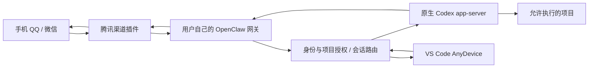

# 架构与控制边界

此文为待实现设计，不是当前运行能力。

## 执行位置

执行始终位于用户指定的电脑或远端工作环境。网关优先和 Codex 在同一环境，用本机 stdio 连接；手机使用腾讯消息渠道，不直接连接实验性的 app-server 端口。电脑休眠、离线或 VS Code 退出后的行为必须明确显示。

新任务原型先复用 OpenClaw 原生 Codex 路由。VS Code 生命周期和长驻网关生命周期分开：扩展关闭不等于网关任务被停止。是否需要独立服务必须在原型后确定，不能让 VS Code 退出导致状态无声丢失。

本地窗口在本地执行；Remote SSH/容器窗口对应其远端项目。尚未实现的远端部署不自动转回本机运行，不通过手机消息创建任意 SSH 连接。

## 模块边界

| 模块 | 责任 |
| --- | --- |
| VS Code 扩展 | 项目登记与授权、任务与会话列表、交接界面、配置与诊断 |
| 渠道适配 | 复用腾讯 QQ/微信插件，校验原始渠道身份，规范消息与回传 |
| 网关控制层 | 项目别名路由、权限、幂等、并发与重连；不再调用额外模型解释普通命令 |
| Codex 后端 | 官方 app-server 原生线程、轮次、审批与事件 |
| 状态存储 | 最小路由与操作状态；单独定义隐私保留与清理 |

初始仓库只实现扩展的文档入口；后续在验证 OpenClaw 能力后建立控制层代码与接口，不提前假定未核实的 OpenClaw 内部 API。

## 身份、项目和请求

每个指令绑定 `channel + accountId + senderId + conversationId + projectId + threadId`；不得使用昵称或聊天标题作为身份。QQ OpenID 随机器人账号变化。默认私聊，允许聊天与允许审批分别管理。

手机仅传项目别名；项目路径由电脑端显式登记。跨项目和绝对路径输入不自动获得授权。每个原生 thread 只有一个可写控制者；文件修改以 Codex 自身权限和沙箱为基础，不接受任意 shell 文本作为网关命令。

消息 ID、操作 ID、thread ID 和 turn ID 分别记录；指令重放不能简单再次执行。重启后结果不确定的操作标为“状态未确认”，查证后继续。不能从网络层的确认推断项目已成功修改。

审批携带准确 request ID、thread/turn 和到期时间，只能由指定审批人回答；过期、已解决和错会话答复无效。拒绝或超时不能变成批准。异步提问的回复是续聊或 steer，不能套用阻塞工具审批语义。

## 状态

`queued → running → waiting_question / waiting_approval → running → completed / failed / cancelled`。断连或无法核实完成时使用 `unknown`。结束一轮只表示该轮结束；后台部署、训练等外部工作需另有证据。

## 与 Beacon 共存

使用 `Young581.codex-anydevice`、`codexAnyDevice.*` 和独立存储目录。Beacon 的历史、Hook、证书、隐私暂停和设置不被迁移或覆盖。未来若复用 Beacon 源码，必须保留原 MIT 版权并登记来源；本次骨架没有复制它的运行时代码。
