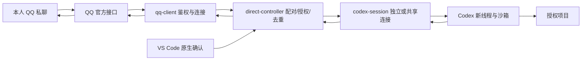

# 架构与控制边界

0.6.2 使用带版本标签和 SHA-256 审计的 GitHub Release 分发；管理面板仅展示日常配置与会话操作。保留 QQ 官方 WebSocket、多目录授权与切换、新线程、空闲原线程续聊、分页对话查看和指令提示/可选填入按钮，实际账号、手机与模型任务待验收。

## 模块与生命周期

| 模块 | 责任 |
| --- | --- |
| setup-controller / setup-model | 向导、SecretStorage、项目与配置变更撤销 |
| qq-client | token、单分片 WSS、C2C、心跳/ACK、Resume、刷新、有界重试和被动回复 |
| direct-controller | 配对、电脑授权、串行队列、匿名去重、单任务、取消与审批 |
| codex-session | 精确版本、stdio、独立线程/轮次、有效策略检查、准确请求匹配与中断 |

激活不自动连接或读取密钥，不重放任务；用户点击连接后恢复已确认身份，首次才生成配对码并在电脑确认身份与项目。`/new` 创建新线程，`/continue` 经共享后端恢复所选原线程。由官方扩展拥有原生 stdio 后端；认证本机代理复用这条连接，隔离前端 RPC ID、路由请求与单线程写入。QQ 断开只中断手机线程，不杀桌面后端。详见 [官方同步](official-sync.md)。退出、重载、断开或终止连接失败只撤销实时连接、停止拥有的进程并标记未知结果，保留持久配对。Windows 按创建的子进程 PID 清理其进程树。

同一 OS 用户下，用 AppID 派生的 loopback 端口跨窗口占用，监听立即销毁入站连接，不提供控制接口或数据。OS 在进程退出时释放；碰撞或其他端口占用保守拒绝。

## 身份、项目与去重

只处理外层 C2C 私聊身份，禁用群聊与引用身份。8 位随机十六进制代码 5 分钟、最多 5 次、一次性并经电脑确认。AppID、已确认 OpenID、项目授权与续聊目标在独立 globalState 保存。登记资料不自动授权；旧版/手工 OpenID 可以在电脑显式确认后记住。重启或断开后恢复已确认身份。更换机器人或手工修改身份撤销全部授权；切换项目保留身份，需电脑授权新项目。取消记住配对同时清除项目授权与续聊目标。存储变更串行，迟到确认核对连接 epoch、身份和项目，不能恢复已撤销授权。

项目从当前本地工作区、已保存列表或本机文件夹选择器明确选择，核对真实目录；最多 20 个，每个目录单独电脑授权，分别保存续聊目标。QQ `/projects` 只返回授权项目别名，`/project 编号` 重新核对授权、真实目录、连接 epoch 与空闲状态后切换，不断开机器人或重复配对；切换后清除旧列表、翻页与结果，失效旧查询。执行和审批前重查目录。手机不传路径，任务正文是模型输入，不能用命令文本解析替代原生沙箱。所选目录不是完整读取边界。

消息队列最多 32，执行独立于队列，运行中可响应状态/取消。一个控制器一个活跃任务，一个线程一个写入者。共享模式中，运行中的手机线程禁止桌面另起轮次，恢复不能覆盖已核对的策略；原生完成后解除占用，允许桌面续聊。执行前持久保存 SHA-256(AppID、sender、messageID)，最多 512 条；淘汰推进时间截断，旧事件保守拒绝。保存失败停止接收；重启活跃状态为 unknown，不重放。该日志不是文件事务或恰好一次执行保证。

`/sessions` 每页取所选项目 10 条元数据，`/sessions next` 使用有界原生游标继续。`/use` 与电脑选择均重查原生 ID、精确 cwd、空闲及可直接输入状态。`/continue` 再查一次，代理预留线程并阻止桌面写入；拒绝活跃状态和仍在提交的桌面轮次。只使用 `thread/resume(threadId)`，禁止传入 path/history 或 fork，不读取本地历史文件。恢复不指定 sandbox/model，保留原线程策略与模型，收紧额外可写目录/网络/临时目录并验证最终 on-request/user 与有效沙箱。

`/history [编号|next]` 与电脑历史按钮走独立只读请求：每页先 `thread/read(includeTurns:false)` 重查精确 ID/cwd，再 `thread/turns/list(limit:1,sortDirection:desc,itemsView:full)`。代理只提取 userMessage 文本与 agentMessage.text，过滤工具、推理和附件；将同轮文本连续切分为最多 1400 字符，原生游标与页内偏移继续长文本及更早轮次，不丢弃长对话尾部。原生完整响应不经手机传输；过滤后的页才进入 1 MiB 手机通道。历史查看不恢复线程、不选中续聊目标、不发模型请求，游标只留内存。

日志仅含哈希、时间、最近随机任务 ID/状态，以及白名单中的错误类别和任务阶段，无原始身份、目录、prompt、结果、原始错误正文或 native IDs。状态为 starting/running/waitingApproval/cancelling/completed/failed/cancelled/unknown；中断确认前不宣称取消或回滚完成。明确尚未发起 turn/start 或收到该请求的 JSON-RPC 拒绝可记 failed；提交后的连接中断保留 unknown。

## 原生策略与审批

锁定 **0.162.0-alpha.17.2**，使用 `on-request` 与 `approvalsReviewer: user`，继承 CLI 认证、模型和服务商。请求单项目 workspace-write、工具网络关闭及临时额外写入关闭；核对返回有效策略才发起轮次。工作目录自动作为可写根，`writableRoots` 是额外目录；接受空数组或仅包含原工作目录的等价表示，其他根仍拒绝。轮次不覆盖 cwd、审批或沙箱策略，继承已核对线程的完整原生限制，避免旧式沙箱字段遗漏读取规则。更严格 readOnly 保留并提示，其余不匹配拒绝。精确证据见[原型](qq-direct-poc.md)。

请求精确绑定 requestId/threadId/turnId/itemId 与原生 startedAtMs，最多 2 分钟。电脑显示完整有界请求，仅 accept/decline，不自动审批、会话批准或持久规则。已解决、过期、结束、取消、配置变化的窗口不能允许其他请求。

缺少内容的文件审批、会话 grantRoot、终端输入、权限工具、动态工具、MCP elicitation 与提问等未实现请求拒绝或停止，不伪装成功。结果仅取 agentMessage 完成事件，最新最多 20,000 字符留内存，QQ 返回摘要。固定诊断阶段为版本、初始化、线程、轮次提交及等待结果；error 和 turn/completed 的 codexErrorInfo 只映射为固定类别，不保存 message/additionalDetails。重试中的通知不提前终止任务。失败类别与阶段在桌面、QQ 最终回复和 /status 中显示，重载后从匿名记录恢复；旧执行的诊断也核对 epoch 与 operation。

## 渠道边界

REST 与 token 固定使用腾讯文档的 `api.bot.qq.com`。Gateway 仅接受 `api.bot.qq.com`、官方 SDK 使用的 `api.sgroup.qq.com` 两个确切主机，协议为 WSS、标准端口、路径为 `/websocket` 或 `/websocket/`，无用户信息、查询参数或片段；不接受任意 QQ 子域或手填替代地址。拒绝 HTTP 凭据重定向，地址失败仅展示 transport/host/path/options 类别，不展示原地址或服务端错误正文。官方固定版本证据见[直连原型](qq-direct-poc.md)。单分片，最多 6 次连续恢复尝试；无 ACK 重连，token 到期前刷新。回复使用 msg_id/msg_seq，保守 5 分钟与最多 4 次，不盲目重试或提供主动额度回退。

`/help`、`/` 与已发送的指令前缀提供白名单匹配，不执行不完整的任务命令。可选 commandButtons 默认为 false，使用 QQ Markdown 和自定义 keyboard；type 2、permission.type 0 + 当前发信人、固定 data、enter:false。明确 HTTP 400/403 拒绝后本次连接停用按钮并以递增 msg_seq 回退文字，超时等不确定发送不重试。机器人账号自定义按钮权限及客户端支持需真机验收，插件无法获知未发送的输入。

电脑持续运行；Webhook、多分片、微信、远程宿主和后台服务后续独立开发。`Young581.codex-anydevice`、`codexAnyDevice.*` 与存储独立，不修改 Beacon 的设置、Hook、证书或缓存。日志观察、fork、原线程续聊与运行中接管分别验收。
